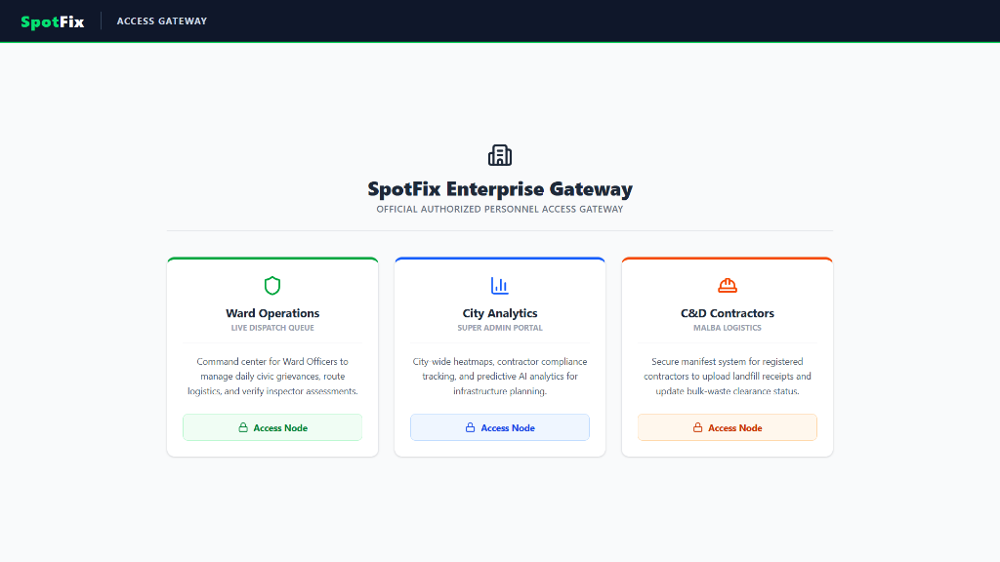
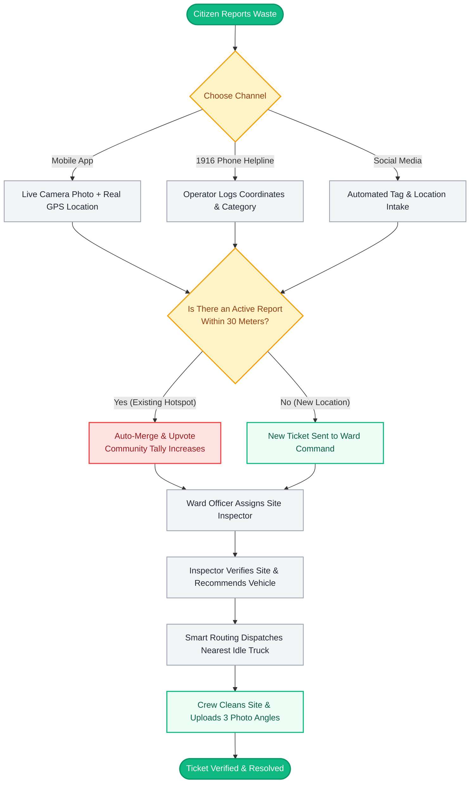
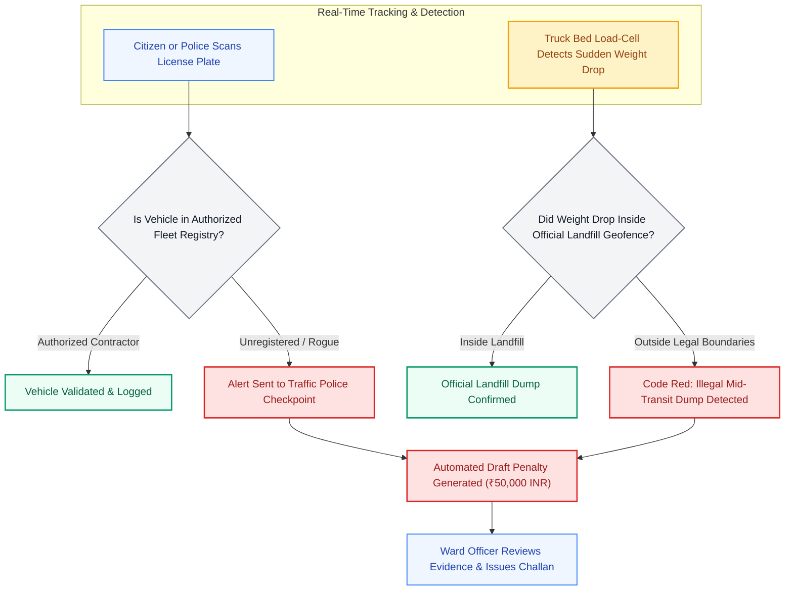
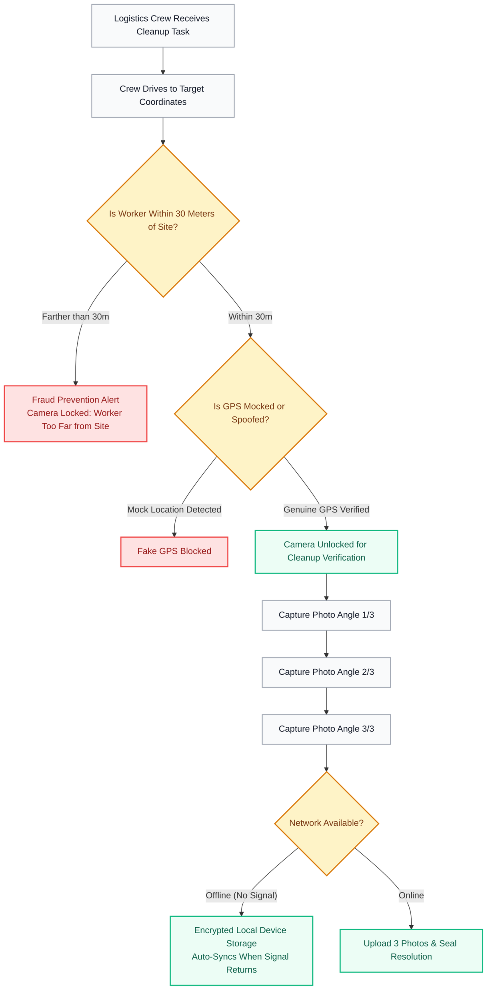
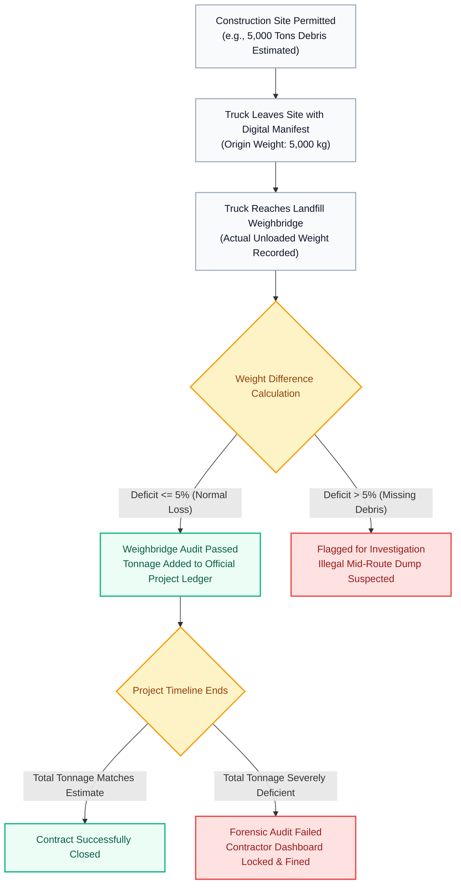

# SpotFix 🌿🚛
### *Omnichannel Civic Grievance & Intelligent Anti-Dumping Enforcement Network*

[](https://nodejs.org/)
[](https://expressjs.com/)
[](https://react.dev/)
[](https://tailwindcss.com/)
[](https://flutter.dev/)
[](https://www.mongodb.com/)
[](https://firebase.google.com/)
[](LICENSE)

---

<p align="center">
  
  
</p>
<p align="center">
  <em><b>SpotFix Dual Command Ecosystem:</b> Enterprise Web Control Gateway (Desktop) &amp; Multi-Role On-Ground Field Engine (Mobile)</em>
</p>

---

## 🌟 The Urban Crisis & The SpotFix Solution

Modern metropolitan cities face two massive, compounding civic crises:

1. **The Citizen Complaint Avalanche:** When a public dumpster overflows, dozens of concerned citizens report the exact same location. Municipal control rooms become paralyzed under thousands of duplicate tickets, leaving officials blind to which sites are genuine emergencies.
2. **The "Malba" Dark Economy:** Millions of tons of Construction & Demolition (C&D) debris are dumped illegally under cover of darkness onto highways, mangroves, and empty plots. Rogue contractors pocket landfill disposal fees, while cities foot astronomical cleanup bills.
3. **The "Ghost Cleanup" Loophole:** Subcontracted cleanup crews frequently mark civic tickets as resolved from the comfort of their homes without ever clearing the waste.
4. **Signal Blackouts:** Reports taken in basements, underground passages, or congested alleys fail silently due to spotty cellular coverage.

### The SpotFix Breakthrough
**SpotFix** replaces fragmented municipal response systems with an **intelligent, tamper-evident civic coordination network**. By combining **spatial deduplication**, **IoT vehicle weight sensors**, **camera-based license plate recognition**, and **automated nearest-truck routing**, SpotFix connects citizens, field inspectors, logistics crews, traffic police, contractors, and weighbridges into one unified, real-time operating system.

```
       📱 Citizens  •  📞 1916 Helpline  •  🐦 Social Channels
                                │
                                ▼
                 ┌─────────────────────────────┐
                 │    SpotFix Spatial Engine   │
                 │   30m Dedupe & 50m Hotspots │
                 └──────────────┬──────────────┘
                                │
               ┌────────────────┴────────────────┐
               ▼                                 ▼
   [General Civic Waste]              [Rogue C&D / Malba]
   • Community Upvote Clustering      • IoT Mid-Transit Dump Detection
   • Ward Inspection Pipeline         • Weighbridge Mass-Balance Audit
   • Nearest-Truck VRP Dispatch       • ANPR Checkpoint Interception
   • 3-Angle Geo-Fenced Proof         • Automated ₹50,000 Fine Packages
```

---

## 🏆 The 4 Pillars of Anti-Dumping Enforcement

SpotFix introduces an airtight four-layer net to eradicate illegal debris dumping:

```
┌────────────────────────────────────────────────────────────────────────┐
│               THE 4 PILLARS OF SPOTFIX DEBRIS ENFORCEMENT              │
├────────────────────────────────┬───────────────────────────────────────┤
│ 🔍 Pillar 1: Visual ANPR Check │ Instant license plate recognition on  │
│    Citizen & Police Cameras    │ commercial dumpers cross-checked with │
│                                │ municipal contractor registries.      │
├────────────────────────────────┼───────────────────────────────────────┤
│ ⚖️ Pillar 2: Smart IoT Bed     │ Truck-mounted load cells stream weight│
│    Telemetry & Geofencing      │ drops in real-time. Unauthorized drops│
│                                │ outside legal landfills trigger ₹50k  │
│                                │ fines automatically.                  │
├────────────────────────────────┼───────────────────────────────────────┤
│ 📊 Pillar 3: Mass Balance      │ Digital ledger reconciles excavation  │
│    Volumetric Audit            │ site estimates with certified landfill│
│                                │ weighbridge receipts at project close.│
├────────────────────────────────┼───────────────────────────────────────┤
│ 📍 Pillar 4: Spatial Hotspot   │ Clusters neighboring debris reports   │
│    Incident Clustering         │ within 50 meters into single unified  │
│                                │ incident zones for macro cleanup.     │
└────────────────────────────────┴───────────────────────────────────────┘
```

---

## 👥 How Every Persona Uses SpotFix

SpotFix is engineered so that every participant in the city has a dedicated, friction-free portal:

### 1. 🙋 Citizens (Mobile App)
- **Point-and-Shoot Simplicity:** Point your camera at a garbage pile or illegal dumping truck. The app captures real GPS coordinates, compresses evidence, and submits in seconds.
- **Three Languages Out of the Box:** Full native support for English, Marathi (मराठी), and Hindi (हिंदी).
- **Consensus with Personal Memory:** If dozens report the same site, the system upvotes the ticket and tallies categories, but your personal *My Tickets* screen always remembers what you submitted.
- **Fair Second Chances:** Made an honest mistake when picking the waste category? Edit your submission once before processing begins.

### 2. 📋 Ward Site Inspectors (Mobile App)
- **Field Queue:** Real-time stream of reports assigned by the Ward Office.
- **On-Site Condition Appraisal:** Inspectors visit the physical location, verify volume, record field notes, and recommend the exact equipment needed (e.g., Mini Tipper vs. JCB Excavator).

### 3. 🏛️ Ward Operations Officers (Enterprise Web Gateway)
- **5-Stage Live Dispatch Pipeline:** Seamlessly moves complaints from *Inbox* → *Pending Assessment* → *Action Required* → *In Cleaning* → *Resolved*.
- **Intelligent Fleet Auto-Dispatch:** Click one button to locate and dispatch the closest available municipal truck matching the required class.
- **Landfill Capacity Management:** Dynamically allocate construction debris to landfills based on live capacity (e.g., Deonar, Mulund, Kanjurmarg).

### 4. 🚛 BMC Logistics Crews (Mobile App)
- **Target Coordinates & Turn-by-Turn Navigation:** Instant dispatch notifications with exact map coordinates.
- **The 30-Meter Geo-Fence:** The camera will not unlock if the crew is farther than 30 meters from the site. No more fake cleanups from across town.
- **3-Angle Verification:** Workers must take three distinct photographic angles of the pristine, cleaned site before ticket closure.

### 5. 👮 Traffic Police Checkpoints (Mobile App)
- **Instant Truck Verification:** Officers aim their camera at commercial dumpers. The app extracts license plates and queries the contractor registry in seconds.
- **Immediate Draft Challan:** If an unregistered or rogue truck is intercepted, officers generate an instant RTO violation package for official fine issuance.

### 6. 📞 1916 Helpline Operators (Enterprise Web Terminal)
- **Universal Civic Access:** For elderly residents or citizens without smartphones dialing the 1916 municipal telephone hotline.
- **Rapid Imageless Intake:** Operators record phone number, category, and street coordinates. The system immediately checks for existing duplicates and dispatches ward resources.

### 7. 🏗️ Construction Contractors (Enterprise Web Portal)
- **Fleet Integration:** Register vehicles with RTO details and link physical IoT load-cell sensor IDs.
- **Digital Manifests:** Generate tamper-evident transit manifests before trucks depart excavation sites.

### 8. ⚖️ Landfill Weighbridge Authorities (Enterprise Web Portal)
- **Incoming Truck Radar:** View every incoming truck currently in transit toward the facility.
- **Digital Weighbridge Auditing:** Log gross unloaded weight. If weight loss exceeds normal moisture tolerances (>5%), the system flags the manifest for investigation.

---

## 📊 Interactive System Workflows

Click each dropdown below to view clear, step-by-step visual diagrams of how SpotFix handles operations:

### 1. The Complete Civic Grievance Journey

<details>
<summary><b>Expand Workflow: How a Report Travels from Citizen to Clean Street</b></summary>
<br>



</details>

---

### 2. Rogue Debris Tracking & Automated Fines

<details>
<summary><b>Expand Workflow: How Illegal Nighttime Dumping is Caught and Penalized</b></summary>
<br>



</details>

---

### 3. The Ward Officer 5-Stage Dispatch Pipeline

<details>
<summary><b>Expand Workflow: How the Ward Command Center Manages Dispatches</b></summary>
<br>


#### The 4 Municipal Vehicle Classes
When an inspector assesses a site, the system dispatches the exact vehicle class required:
- 🚛 **Mini Tipper:** For congested alleys, residential slums, and narrow lanes.
- 🚚 **Refuse Compactor:** Standard enclosed vehicle for regular municipal household waste.
- 🚜 **Open Dumper:** Heavy-duty hauler for bulky construction debris and tree trunks.
- 🏗️ **JCB Excavator:** Heavy earthmover for massive illegal dumps and roadside blockages.

</details>

---

### 4. Fraud-Proof 3-Angle Geo-Fenced Resolution

<details>
<summary><b>Expand Workflow: How False Cleanups are Prevented</b></summary>
<br>



</details>

---

### 5. Construction Debris Mass-Balance Volumetric Audit

<details>
<summary><b>Expand Workflow: How Building Permits Prevent Midnight Dumping</b></summary>
<br>



</details>

---

## 🛡️ Built-In Fail-Safes & Smart Protections

| Everyday Real-World Challenge | The SpotFix Protective Mechanism |
| :--- | :--- |
| **Fake GPS & Location Spoofing** | Automatically interrogates hardware location providers for developer mock flags. Reports with faked coordinates are immediately blocked. |
| **Dead Zones (Basements, Tunnels)** | Automatically saves high-resolution compressed photos and GPS coordinates into an encrypted on-device database, queuing them to sync the moment cellular signal returns. Includes a one-tap direct dialer to the **1916 Telephone Helpline**. |
| **Dying Smartphone Battery** | If phone battery drops below 15%, the app disables high-drain camera flash and adjusts compression settings to prevent devices from shutting down mid-shift. |
| **Duplicate Complaint Floods** | Spatial spherical indexing clusters complaints within 30 meters. Citizens upvote existing reports instead of generating 50 separate work orders for one bin. |
| **Server Bandwidth Bottlenecks** | Mobile clients upload photos directly to high-speed cloud storage using cryptographic tokens, ensuring the municipal API server never slows down during peak morning hours. |
| **Token Timeouts in the Field** | Field workers never get logged out mid-inspection; the app silently refreshes authentication credentials in the background before every request. |

---

## ⚡ Quickstart & Local Setup

Get the full SpotFix ecosystem running on your machine in under 5 minutes:

### 1. Start the Backend API & Seed the Fleet
```bash
# Navigate to backend
cd spotfix-backend

# Install dependencies
npm install

# Seed Mumbai K/East Ward boundary, Deonar Landfill & 20 Dummy Logistics Trucks
node seed.js

# Launch the server
npm run dev
# Running on http://localhost:5000
```

### 2. Launch the Enterprise Web Dashboard
```bash
# Navigate to dashboard
cd spotfix-dashboard

# Install dependencies
npm install

# Launch Vite dashboard
npm run dev
# Running on http://localhost:5173
```
- Open `http://localhost:5173/` for the **Enterprise Gateway**.
- Visit `/ward-officer` to command the live dispatch queue.
- Visit `/contractor-portal` to manage fleet manifests and weighbridge audits.
- Visit `/1916-portal` to test the phone operator terminal.

### 3. Launch the Mobile Application
```bash
# Navigate to mobile app
cd spotfix_app

# Fetch dependencies
flutter pub get

# Run on Chrome, Android, or iOS
flutter run
```

---

<p align="center">
  <b>SpotFix: Intelligent Civic Operations for Modern Metropolitan Cities.</b><br>
  <i>Built with pride for clean roads, transparent governance, and accountable cities.</i>
</p>
