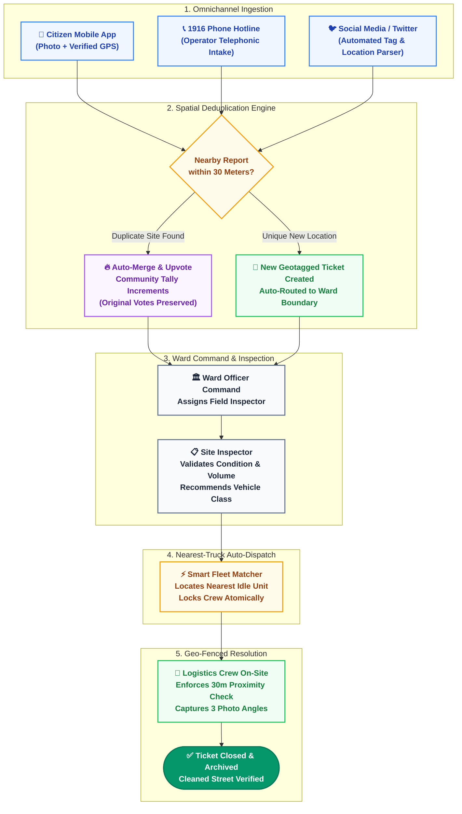
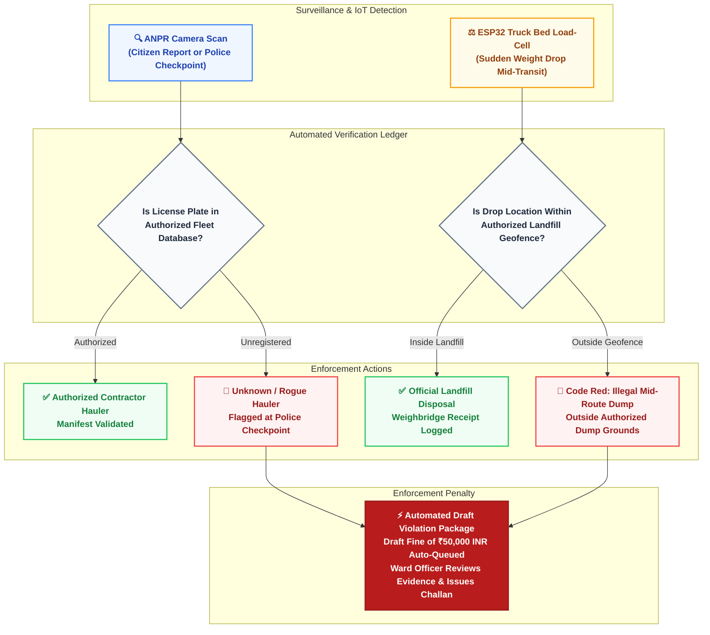
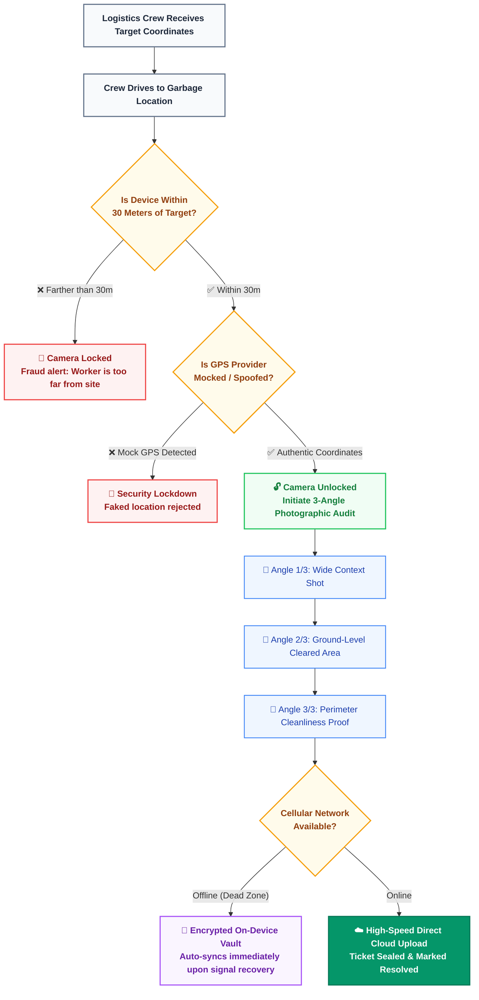
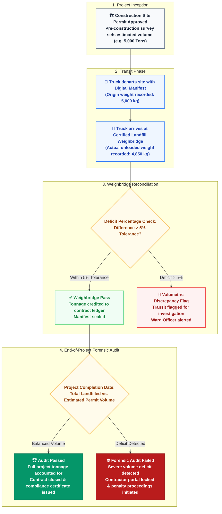

<div align="center">

# SpotFix 🌿🚛
### *Omnichannel Civic Grievance & Intelligent Anti-Dumping Enforcement Network*

[](https://nodejs.org/)
[](https://expressjs.com/)
[](https://react.dev/)
[](https://tailwindcss.com/)
[](https://flutter.dev/)
[](https://www.mongodb.com/)
[](https://firebase.google.com/)
[](LICENSE)

<br/>

<table align="center" width="100%">
  <tr>
    <th width="62%" align="center">🖥️ SpotFix Enterprise Gateway (Web Operations Hub)</th>
    <th width="38%" align="center">📱 SpotFix Mobile App (Citizen &amp; Enforcement Portal)</th>
  </tr>
  <tr>
    <td align="center" valign="middle">
      
      <br/><br/>
      <sub><b>Official Command Node:</b> Real-time grievance dispatch, multi-ward triage, contractor fleet tracking &amp; landfill capacity allocation.</sub>
    </td>
    <td align="center" valign="middle">
      
      <br/><br/>
      <sub><b>Field-Ready Mobile Engine:</b> Multilingual role switcher for Citizens, Site Inspectors, Logistics Crews &amp; Traffic Police.</sub>
    </td>
  </tr>
</table>

</div>

---

## 🌟 The Urban Crisis & The SpotFix Solution

Modern metropolitan cities face two compounding civic crises:

1. **The Citizen Complaint Avalanche:** When a public dumpster overflows, dozens of concerned citizens report the exact same location. Municipal control rooms become paralyzed under thousands of duplicate tickets, leaving officials blind to which sites are genuine emergencies.
2. **The "Malba" Dark Economy:** Millions of tons of Construction & Demolition (C&D) debris are dumped illegally under cover of darkness onto highways, mangroves, and empty plots. Rogue contractors pocket landfill disposal fees, while cities foot astronomical cleanup bills.
3. **The "Ghost Cleanup" Loophole:** Subcontracted cleanup crews frequently mark civic tickets as resolved from the comfort of their homes without ever clearing the waste.
4. **Signal Blackouts:** Reports taken in basements, underground passages, or congested alleys fail silently due to spotty cellular coverage.

### The SpotFix Breakthrough
**SpotFix** replaces fragmented municipal response systems with an **intelligent, tamper-evident civic coordination network**. By combining **spatial deduplication**, **IoT vehicle weight sensors**, **camera-based license plate recognition**, and **automated nearest-truck routing**, SpotFix connects citizens, field inspectors, logistics crews, traffic police, contractors, and weighbridges into one unified, real-time operating system.

| Intake Channels | Intelligence Layer | Operational Outcomes |
| :--- | :--- | :--- |
| 📱 **Mobile App Reports**<br/>Live camera capture + genuine GPS | 📍 **30m Spatial Deduplication**<br/>Auto-merges nearby reports & upvotes | 🚛 **Smart Fleet Routing**<br/>Dispatches nearest idle municipal truck |
| 📞 **1916 Phone Hotline**<br/>Rapid telephonic intake for all citizens | 🔍 **50m Malba Hotspots**<br/>Clusters illegal debris into macro zones | 🛡️ **30m Geo-Fence Enforcer**<br/>Blocks remote closures from home |
| 🐦 **Social Media Channels**<br/>Automated Twitter/X tag ingestion | ⚖️ **IoT Load-Cell Telemetry**<br/>Real-time bed weight drop surveillance | 📸 **3-Angle Photo Verification**<br/>Ensures indisputable proof of clean streets |

---

## 🏆 The 4 Pillars of Anti-Dumping Enforcement

SpotFix introduces an airtight four-layer net to eradicate illegal debris dumping:

| Pillar | Focus | Technology & Mechanism | Enforcement Outcome |
| :---: | :--- | :--- | :--- |
| **01** | **Visual ANPR Plate Check** | Citizen & Police cameras scan commercial dumper plates | Instant cross-reference against municipal fleet database; flags unregistered rogue trucks. |
| **02** | **Smart IoT Bed Telemetry** | ESP32 load-cells stream real-time weight on truck beds | Sudden weight drop outside authorized landfill geofences triggers automated **₹50,000 INR** fines. |
| **03** | **Mass Balance Volumetric Audit** | Certified digital ledger matches permits to weighbridges | Reconciles excavation volume with landfill drop-off receipts before closing contractor contracts. |
| **04** | **Spatial Hotspot Clustering** | Proximity engine groups repeat reports within 50 meters | Unifies fragmented complaints into a single macro incident zone for high-capacity excavator dispatch. |

---

## 👥 How Every Persona Uses SpotFix

SpotFix provides tailored, role-specific interfaces segmented across two platforms: the **Mobile Field App** for on-ground execution, and the **Enterprise Web Console** for central command and oversight.

### 📱 Mobile Application Personas (On-Ground Field Operations)
Built with Flutter for high performance, camera-first workflows, offline resilience, and multilingual support (English, Marathi मराठी, and Hindi हिंदी).

#### 1. 🙋 Citizen / Omnichannel Reporter
- **Point-and-Shoot Live Reporting:** Fast, frictionless camera capture for garbage dumps and rogue debris. Captures genuine GPS, compresses media, and uploads seamlessly.
- **Multilingual By Default:** Instant language switching across English, Marathi, and Hindi.
- **Democratic Consensus with Memory:** When multiple citizens report the same site, the system upvotes the collective ticket, while preserving your personal submission history in *My Tickets*.
- **Fair Single-Correction Window:** Made an accidental category error? Edit your category once before official processing begins.
- **Dead-Zone Offline Vault:** Automatically caches reports with full GPS data into on-device local storage when offline, offering a one-tap direct dialer to the **1916 Telephone Helpline**.

#### 2. 📋 Ward Site Inspector
- **Real-Time Field Triage Queue:** Inspects tickets routed from the Ward Office awaiting on-site physical appraisal.
- **Site Condition Appraisal:** Records on-site conditions, estimates debris volume, and recommends the required vehicle class (Mini Tipper, Compactor, Open Dumper, or JCB).
- **Status Upgrade:** Submits field notes to promote tickets to *Field Verified*, unlocking one-click fleet dispatch for the Ward Officer.

#### 3. 🚛 BMC Logistics Cleanup Crew
- **Turn-by-Turn GPS Dispatch:** Real-time routing directly to target coordinates with vehicle assignment logs.
- **The 30-Meter Anti-Fraud Geo-Fence:** Hardware camera strictly locks if the crew is farther than 30 meters from the site, preventing remote or fraudulent ticket closures.
- **3-Angle Photographic Audit:** Crew must capture 3 distinct verification angles of the cleaned, restored street before resolution is permitted.
- **Offline Resolution Sync:** If cellular signal drops at the dump site, all 3 photo angles are saved locally and auto-synced the moment connection is restored.

#### 4. 👮 Traffic Police Enforcement Checkpoint
- **Live ANPR License Plate Scanner:** Point camera at commercial dumper trucks to extract number plates in seconds.
- **Fleet Registry Verification:** Cross-checks plates against active municipal contractor permits in real-time.
- **Instant Draft Penalty Issuance:** If an unauthorized or rogue hauler is intercepted, triggers an instant RTO violation package for official fine approval.

---

### 🖥️ Enterprise Web Gateway Personas (Command & Oversight Hub)
Built with React 19, Vite, and Tailwind CSS for real-time dispatch, multi-ward triage, contractor compliance, and city-wide analytics.

#### 1. 🏛️ Ward Operations Officer (`/ward-officer`)
- **5-Stage Live Dispatch Queue:** Command center moving grievances across *Inbox* → *Pending Assessment* → *Action Required* → *In Cleaning* → *Resolved*.
- **50m Malba Incident Zone Clustering:** Detects and groups neighboring debris reports within 50 meters into single macro work orders.
- **Automated Nearest-Truck Dispatch:** Uses spherical distance matching to route the closest idle crew matching the inspector's recommended vehicle class:
  - 🚛 *Mini Tipper* (Congested lanes & slums)
  - 🚚 *Refuse Compactor* (Standard municipal waste)
  - 🚜 *Open Dumper* (Bulky construction rubble)
  - 🏗️ *JCB Excavator* (Severe illegal dumps & landslides)
- **Landfill Target Allocations:** Allocates disposal quotas across municipal dumping grounds (Deonar, Mulund, Kanjurmarg) based on live capacities before authorizing contracts.

#### 2. 📞 1916 Helpline Operator (`/1916-portal`)
- **Universal Civic Access:** Dedicated terminal for citizens calling the official 1916 municipal telephone helpline.
- **Rapid Imageless Intake:** Form-based entry capturing caller phone, category, and street coordinates.
- **Automatic Duplication & Merge Check:** Merges with existing 30m neighborhood reports and dispatches SMS confirmation to the caller.

#### 3. 🏗️ Registered C&D Contractor (`/contractor-portal`)
- **Fleet Registration & Sensor Integration:** Registers trucks with RTO license plates and links unique physical IoT load-cell sensor IDs.
- **Site Clearance Permits:** Requests new construction debris permits with estimated tonnage.
- **Digital Dispatch Manifests:** Generates tamper-evident manifests before trucks depart excavation sites, alerting receiving landfills of inbound tonnage.

#### 4. ⚖️ Landfill Weighbridge Official (`/contractor-portal`)
- **Inbound Fleet Radar:** Monitors real-time queue of trucks in transit to the dumping ground.
- **Digital Weighbridge Recording:** Records gross unloaded weight at the weighbridge.
- **Volumetric Deficit Audit:** Automatically flags manifests with >5% unexplained weight loss for immediate investigation.

#### 5. 🗺️ City Super Administrator (`/super-admin`)
- **City-Wide Heatmaps & Spatial Analytics:** Panoramic geospatial heatmaps of civic hotspots and recurring dumping corridors.
- **Contractor Compliance Scorecards:** Tracks contractors with recurring weight deficits or unresolved manifests.
- **Predictive Infrastructure Planning:** AI-assisted volume trend forecasting to optimize seasonal route planning and truck allocations.

---

## 📊 Interactive System Workflows

Explore the visual workflows below to see how SpotFix handles end-to-end municipal operations:

---

### 🗺️ Workflow 1: The Complete Civic Grievance Journey

<details>
<summary><b>Click to Expand: Step-by-Step Report Lifecycle (From Photo Snapshot to Cleaned Street)</b></summary>
<br/>



</details>

---

### 🚛 Workflow 2: Rogue Truck Interception & Automated Fines

<details>
<summary><b>Click to Expand: Anti-Dumping Detection (License Plate Check & IoT Geofence Alerts)</b></summary>
<br/>



</details>

---

### ⚡ Workflow 3: The 5-Stage Ward Command Pipeline & Smart Vehicle Routing

```mermaid
flowchart LR
    P1["📥 1. Inbox\nNew incoming grievances\n(Auto-clustered by ward)"]:::step
    P2["🔍 2. Inspection\nAssigned to Field Inspector\nfor site appraisal"]:::step
    P3["📋 3. Action Required\nInspector notes logged\nVehicle class selected"]:::step
    P4["⚡ 4. Smart Fleet Dispatch\nNearest idle truck routed\nvia spherical distance"]:::activeStep
    P5["🎉 5. Resolved\n3-Angle proof confirmed\nTicket archived"]:::doneStep

    P1 -->|"Assign Inspector"| P2
    P2 -->|"Submit Assessment"| P3
    P3 -->|"One-Click Dispatch"| P4
    P4 -->|"Field Verification"| P5

    classDef step fill:#f8fafc,stroke:#cbd5e1,stroke-width:2px,color:#1e293b,font-weight:bold;
    classDef activeStep fill:#eff6ff,stroke:#2563eb,stroke-width:2px,color:#1d4ed8,font-weight:bold;
    classDef doneStep fill:#ecfdf5,stroke:#059669,stroke-width:2px,color:#065f46,font-weight:bold;
```

<details>
<summary><b>Click to Expand: Ward Command Operations & Matching the 4 Vehicle Classes</b></summary>
<br/>



#### The 4 Municipal Vehicle Classes
When an inspector assesses a site, the system dispatches the exact vehicle class required:
- 🚛 **Mini Tipper:** For congested alleys, residential slums, and narrow lanes.
- 🚚 **Refuse Compactor:** Standard enclosed vehicle for regular municipal household waste.
- 🚜 **Open Dumper:** Heavy-duty hauler for bulky construction debris and tree trunks.
- 🏗️ **JCB Excavator:** Heavy earthmover for massive illegal dumps and roadside blockages.

</details>

---

### 🛡️ Workflow 4: The 30m Geo-Fenced 3-Angle Resolution Protocol

<details>
<summary><b>Click to Expand: How SpotFix Eliminates "Ghost Cleanups" and Validates Clean Streets</b></summary>
<br/>



</details>

---

### ⚖️ Workflow 5: Mass-Balance Volumetric Forensic Audit

<details>
<summary><b>Click to Expand: How Building Permits and Weighbridge Receipts Stop Illegal Disposal</b></summary>
<br/>



</details>

---

## 🛡️ Built-In Fail-Safes & Smart Protections

| Everyday Real-World Challenge | The SpotFix Protective Mechanism |
| :--- | :--- |
| **Fake GPS & Location Spoofing** | Automatically interrogates hardware location providers for developer mock flags. Reports with faked coordinates are immediately blocked. |
| **Dead Zones (Basements, Tunnels)** | Automatically saves high-resolution compressed photos and GPS coordinates into an encrypted on-device database, queuing them to sync the moment cellular signal returns. Includes a one-tap direct dialer to the **1916 Telephone Helpline**. |
| **Dying Smartphone Battery** | If phone battery drops below 15%, the app disables high-drain camera flash and adjusts compression settings to prevent devices from shutting down mid-shift. |
| **Duplicate Complaint Floods** | Spatial spherical indexing clusters complaints within 30 meters. Citizens upvote existing reports instead of generating 50 separate work orders for one bin. |
| **Server Bandwidth Bottlenecks** | Mobile clients upload photos directly to high-speed cloud storage using cryptographic tokens, ensuring the municipal API server never slows down during peak morning hours. |
| **Token Timeouts in the Field** | Field workers never get logged out mid-inspection; the app silently refreshes authentication credentials in the background before every request. |

---

## 📂 Monorepo Architecture

SpotFix is organized into three clean, production-ready modules:

- **`spotfix-backend/`** — High-performance Node.js & Express 5 core engine. Hosts MongoDB geospatial spherical indexing, Firebase authentication, Cloudinary signed image uploads, IoT sensor ingestion, and automated VRP fleet matching.
- **`spotfix-dashboard/`** — React 19 & Tailwind CSS enterprise web console. Houses the Ward Officer live dispatch queue, 1916 telephonic intake, contractor fleet hub, landfill weighbridge radar, and city analytics.
- **`spotfix_app/`** — Flutter cross-platform mobile application. Delivers camera-first live reporting, native multilingual support (EN/MR/HI), anti-spoofing GPS checks, 30m fraud-proof geo-fencing, 3-angle photo verification, and offline Hive database caching.

---

## ⚡ Quickstart & Local Setup

Get the full SpotFix ecosystem running on your machine in under 5 minutes:

### 1. Start the Backend API & Seed the Fleet
```bash
# Navigate to backend
cd spotfix-backend

# Install dependencies
npm install

# Seed Mumbai K/East Ward boundary, Deonar Landfill & 20 Dummy Logistics Trucks
node seed.js

# Launch the server
npm run dev
# Running on http://localhost:5000
```

### 2. Launch the Enterprise Web Dashboard
```bash
# Navigate to dashboard
cd spotfix-dashboard

# Install dependencies
npm install

# Launch Vite dashboard
npm run dev
# Running on http://localhost:5173
```
- Open `http://localhost:5173/` for the **Enterprise Gateway**.
- Visit `/ward-officer` to command the live dispatch queue.
- Visit `/contractor-portal` to manage fleet manifests and weighbridge audits.
- Visit `/1916-portal` to test the phone operator terminal.

### 3. Launch the Mobile Application
```bash
# Navigate to mobile app
cd spotfix_app

# Fetch dependencies
flutter pub get

# Run on Chrome, Android, or iOS
flutter run
```

---

<p align="center">
  <b>SpotFix: Intelligent Civic Operations for Modern Metropolitan Cities.</b><br>
  <i>Built with pride for clean roads, transparent governance, and accountable cities.</i>
</p>
