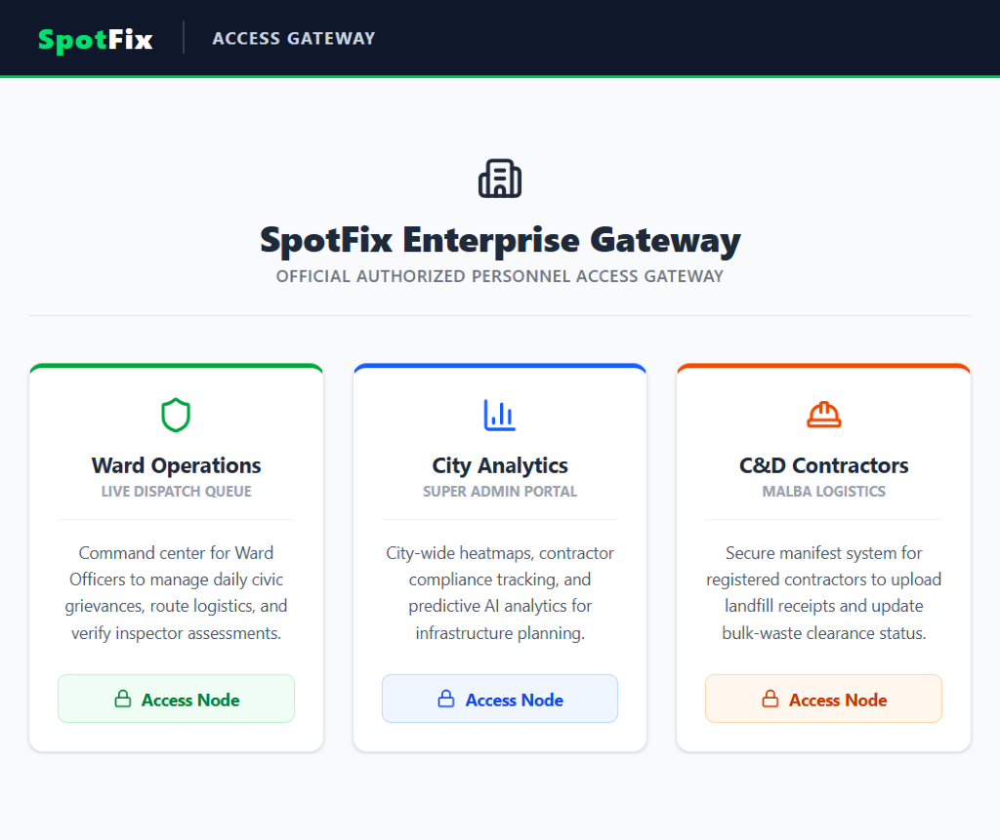
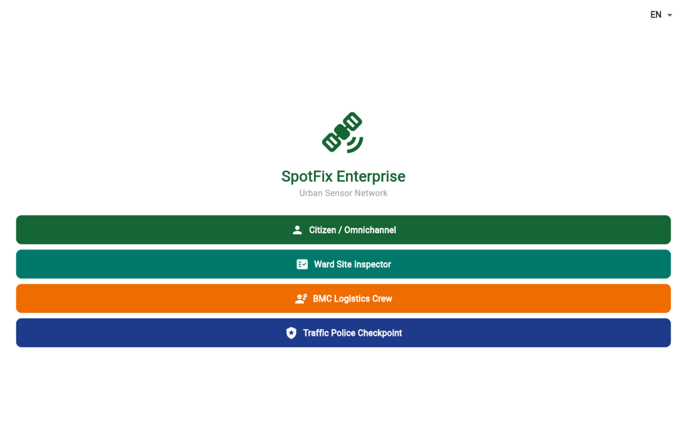
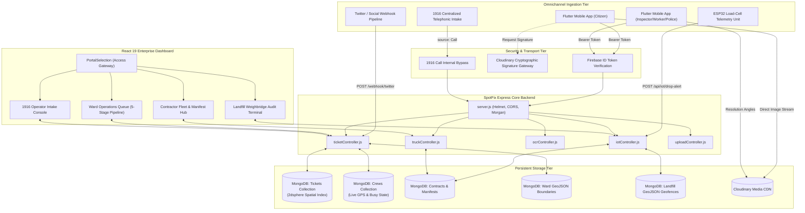
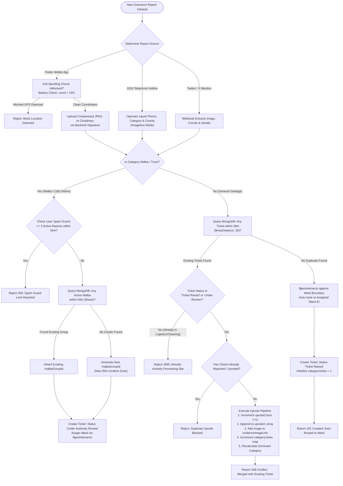
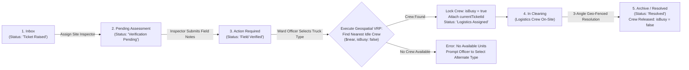
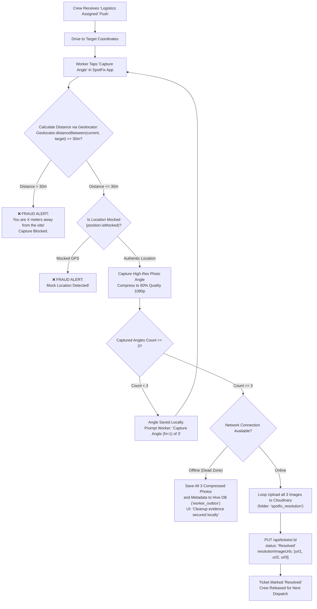
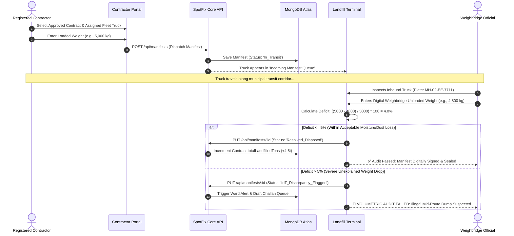

# SpotFix 🌿🚛
### *Omnichannel Civic Grievance & Intelligent Construction Waste (Malba) Enforcement Network*

[](https://nodejs.org/)
[](https://expressjs.com/)
[](https://react.dev/)
[](https://vitejs.dev/)
[](https://tailwindcss.com/)
[](https://flutter.dev/)
[](https://www.mongodb.com/)
[](https://firebase.google.com/)
[](https://cloudinary.com/)
[](https://pub.dev/packages/hive)
[](LICENSE)

---

## 🏛️ Official Web & Mobile Landing Interfaces

<table>
  <tr>
    <th width="62%" align="center"><b>🖥️ SpotFix Enterprise Gateway (Web Operations Hub)</b></th>
    <th width="38%" align="center"><b>📱 SpotFix Mobile App (Citizen & Enforcement Portal)</b></th>
  </tr>
  <tr>
    <td align="center" valign="top">
      
      <br/>
      <sub><em>Command node for Ward Officers, City Planners & C&D Contractors</em></sub>
    </td>
    <td align="center" valign="top">
      
      <br/>
      <sub><em>Multilingual role gateway (Citizen, Site Inspector, Logistics Crew, Traffic Police)</em></sub>
    </td>
  </tr>
</table>

---

## 📌 Table of Contents

- [SpotFix 🌿🚛](#spotfix-)
    - [*Omnichannel Civic Grievance & Intelligent Construction Waste (Malba) Enforcement Network*](#omnichannel-civic-grievance--intelligent-construction-waste-malba-enforcement-network)
  - [🏛️ Official Web & Mobile Landing Interfaces](#️-official-web--mobile-landing-interfaces)
  - [📌 Table of Contents](#-table-of-contents)
  - [🌟 Executive Overview](#-executive-overview)
    - [The Municipal Challenge](#the-municipal-challenge)
    - [The SpotFix Breakthrough](#the-spotfix-breakthrough)
  - [🏆 The 4 Pillars of C&D (Malba) Anti-Dumping Enforcement](#-the-4-pillars-of-cd-malba-anti-dumping-enforcement)
  - [🎯 Key Architectural Highlights](#-key-architectural-highlights)
  - [👥 Persona Ecosystem & Access Nodes](#-persona-ecosystem--access-nodes)
  - [📊 Interactive Expandable Flowcharts](#-interactive-expandable-flowcharts)
    - [1. Macro System Architecture & Data Plane](#1-macro-system-architecture--data-plane)
    - [2. Omnichannel Ingestion & 30m Spatial Deduplication Engine](#2-omnichannel-ingestion--30m-spatial-deduplication-engine)
    - [3. The 4-Pillar C&D Anti-Dumping & IoT Telemetry Flow](#3-the-4-pillar-cd-anti-dumping--iot-telemetry-flow)
    - [4. Ward Officer 5-Stage Dispatch & VRP Nearest-Truck Routing](#4-ward-officer-5-stage-dispatch--vrp-nearest-truck-routing)
    - [5. Field Logistics Crew Geo-Fence Check & 3-Angle Verification Protocol](#5-field-logistics-crew-geo-fence-check--3-angle-verification-protocol)
    - [6. Digital Manifest to Landfill Weighbridge Mass-Balance Audit](#6-digital-manifest-to-landfill-weighbridge-mass-balance-audit)
  - [📂 Monorepo Repository Structure](#-monorepo-repository-structure)
  - [🗄️ Database Schemas & Geospatial Indexes](#️-database-schemas--geospatial-indexes)
  - [🔌 REST API Specification](#-rest-api-specification)
  - [🚀 Quickstart & Local Setup Guide](#-quickstart--local-setup-guide)
    - [Prerequisites](#prerequisites)
    - [1. Backend Initialization & Database Seeding](#1-backend-initialization--database-seeding)
    - [2. Web Enterprise Dashboard Startup](#2-web-enterprise-dashboard-startup)
    - [3. Flutter Mobile App Startup](#3-flutter-mobile-app-startup)
  - [🛡️ Resilience, Security & Offline Guarantees](#️-resilience-security--offline-guarantees)
  - [🤝 Contributing](#-contributing)
  - [📄 License](#-license)

---

## 🌟 Executive Overview

Metropolitan municipal bodies worldwide face two acute operational hurdles:
1. **Uncontrolled Citizen Complaint Duplication:** Dozens of well-meaning citizens report the exact same garbage pile within meters of each other, flooding ward control rooms with duplicate dispatch tickets while legitimate grievances languish unattended.
2. **The "Malba" Dark Economy:** Illegal nighttime dumping of Construction & Demolition (C&D) debris onto public streets, highway shoulders, and wetlands. Rogue contractors pocket municipal tipping fees, bypass authorized landfills (e.g., Deonar Dumping Ground), and dump tons of concrete rubble unnoticed.

**SpotFix** resolves both challenges through a unified, high-reliability municipal technology stack piloted for municipal corporations (such as BMC Mumbai Ward K/East). By fusing **multilingual mobile interfaces**, **geospatial MongoDB 2dsphere indexing**, **ESP32 IoT telemetry**, **OCR vehicle license plate scanning**, and **real-time Vehicle Routing Problem (VRP) algorithms**, SpotFix turns civic grievance resolution into an automated, fraud-proof digital assembly line.

```
       📱 Citizens / 1916 Calls / Twitter Webhooks
                           │
                           ▼
              ┌─────────────────────────┐
              │  SpotFix Spatial Engine  │
              │  (30m Dedupe / 50m Malba│
              └────────────┬────────────┘
                           │
             ┌─────────────┴─────────────┐
             ▼                           ▼
  [General Civic Waste]       [C&D / Malba Debris]
             │                           │
  • 30m Auto-Upvote           • IoT Drop Telemetry
  • Ward Officer Triage       • 4-Pillar Mass Balance
  • VRP Nearest Fleet         • ANPR Police Intercept
  • 30m Geo-Fence Clearance   • Automated ₹50k Challan
```

---

## 🏆 The 4 Pillars of C&D (Malba) Anti-Dumping Enforcement

SpotFix implements an ironclad forensic framework engineered specifically to dismantle the illegal construction waste pipeline:

| Pillar | Title | Mechanism & Code Implementation | Enforcement Outcome |
| :--- | :--- | :--- | :--- |
| **01** | **Citizen OCR & ANPR Checkpoint** | Citizens or Traffic Police scan commercial dumper plates using in-app camera OCR (`/api/ocr/scan-plate`). Verified against `/api/trucks/verify`. | Unregistered rogue haulers are immediately flagged; draft challans are auto-queued for municipal approval. |
| **02** | **IoT Mid-Route Drop Telemetry** | ESP32 hardware sensors ("Tiffin Box" load cells) stream weight drops with GPS telemetry to `/api/iot/drop-alert`. | If weight drops outside official GeoJSON municipal landfills (`$geoIntersects`), a **Code Red Alert** & **₹50,000 INR Draft Challan** are generated instantly. |
| **03** | **Mass Balance Volumetric Audit** | Pre-construction site permits establish estimated debris tonnage (`estimatedVolumeTons`). Landfill weighbridges digitally sign received tonnage (`totalLandfilledTons`). | If project reaches completion date with severe weight deficits, contractor contract transitions to `Forensic Audit Failed` and dashboard is locked. |
| **04** | **Spatial Hotspot Clustering** | High-density C&D grievances within a 50-meter radius are linked via `malbaGroupId`. | Ward Inspectors receive a unified macro-incident package instead of disconnected tickets, preventing duplicate contractor payouts. |

---

## 🎯 Key Architectural Highlights

- **Omnichannel Ingestion:** Supports reports via the **Flutter mobile app**, the **1916 Centralized Telephone IVR / Operator Portal** (imageless bypass), and automated **Twitter/X Webhooks**.
- **Self-Healing Community Tally:** If multiple citizens report different categories for the same physical hotspot, the system tallies votes and automatically updates the dominant category, while preserving each reporter’s original vote in their personal *"My Tickets"* view.
- **Single-Correction Policy:** Citizens can edit their reported category **exactly once** before administrative processing begins, eliminating accidental user error.
- **Automated VRP Nearest-Truck Dispatch:** Uses spherical distance calculation (`$near`) against idle crews (`isBusy: false`) to dispatch the exact vehicle class needed:
  - 🚛 *Mini Tipper* (Narrow streets & residential lanes)
  - 🚚 *Refuse Compactor* (Standard municipal collection)
  - 🚜 *Open Dumper* (Heavy Malba and concrete blocks)
  - 🏗️ *JCB Excavator* (Severe illegal dumps & landslides)
- **30-Meter Geo-Fenced 3-Angle Resolution:** Field workers cannot mark tickets as cleared from home. SpotFix enforces strict distance calculation (`Geolocator.distanceBetween <= 30m`) and requires **3 distinct photographic angles** of the cleaned site.
- **Dead-Zone Offline Mode:** When operating in basements or cellular dead zones, the Flutter app automatically captures compressed image buffers and coordinates directly into local **Hive DB** outboxes, with instant dial-in fallback to the **1916 hotline**.
- **Direct Signed Cloudinary Uploads:** Mobile clients fetch cryptographic upload signatures from `/api/upload/signature`, uploading photos directly to Cloudinary without choking the Express API server with high-bandwidth image streams.

---

## 👥 Persona Ecosystem & Access Nodes

SpotFix provides tailored, role-specific interfaces designed for every participant in the municipal lifecycle:

```
┌────────────────────────────────────────────────────────────────────────┐
│                        SPOTFIX UNIFIED ECOSYSTEM                       │
├──────────────────────────┬─────────────────────────────────────────────┤
│ 1. Citizen               │ Flutter App (EN / MR / HI)                  │
│    • Live Camera Capture │ • GPS Anti-Spoofing                         │
│    • Single Category Fix │ • Offline Outbox Cache                      │
├──────────────────────────┼─────────────────────────────────────────────┤
│ 2. Ward Site Inspector   │ Flutter App (Inspector Role)                │
│    • On-site Appraisals  │ • Status: 'Field Verified'                  │
│    • Truck Size Guidance │ • Evidence Audit                            │
├──────────────────────────┼─────────────────────────────────────────────┤
│ 3. Ward Operations HQ    │ React 19 Enterprise Dashboard               │
│    • 5-Stage Live Queue  │ • VRP Truck Auto-Dispatch                   │
│    • 50m Hotspot Cluster │ • Landfill Target Allocations               │
├──────────────────────────┼─────────────────────────────────────────────┤
│ 4. BMC Logistics Crew    │ Flutter App (Worker Role)                   │
│    • Target Coordinates  │ • 30m Geo-Fence Enforcer                    │
│    • Turn-by-Turn Nav    │ • 3-Angle Resolution Upload                 │
├──────────────────────────┼─────────────────────────────────────────────┤
│ 5. Traffic Police        │ Flutter App (Enforcement Role)              │
│    • Live Camera ANPR    │ • RTO / BMC Database Cross-Check            │
│    • Plate Verification  │ • Instant Draft Challan Trigger             │
├──────────────────────────┼─────────────────────────────────────────────┤
│ 6. 1916 Call Intake      │ React 19 Operator Terminal                  │
│    • Rapid Phone Intake  │ • Imageless Ticket Dispatch                 │
│    • SMS Confirmations   │ • Auto-Merge Duplication Check              │
├──────────────────────────┼─────────────────────────────────────────────┤
│ 7. C&D Contractor        │ React 19 Logistics Portal                   │
│    • Fleet Integration   │ • Digital Dispatch Manifests                │
│    • IoT Sensor Linking  │ • Site Disposal Contracts                   │
├──────────────────────────┼─────────────────────────────────────────────┤
│ 8. Landfill Authority    │ React 19 Weighbridge Portal                 │
│    • Inbound Fleet Queue │ • Unloaded Weight Entry                     │
│    • GeoJSON Enclosure   │ • Volumetric Deficit Detection              │
└──────────────────────────┴─────────────────────────────────────────────┘
```

---

## 📊 Interactive Expandable Flowcharts

Click each dropdown below to explore detailed Mermaid flowcharts covering every layer of the SpotFix architecture:

### 1. Macro System Architecture & Data Plane

<details>
<summary><b>Expand Flowchart: Macro System Architecture & Data Plane</b></summary>



</details>

---

### 2. Omnichannel Ingestion & 30m Spatial Deduplication Engine

<details>
<summary><b>Expand Flowchart: Omnichannel Ingestion & Deduplication</b></summary>



</details>

---

### 3. The 4-Pillar C&D Anti-Dumping & IoT Telemetry Flow

```mermaid
flowchart TD
    subgraph PILLAR_1["Pillar 1: ANPR & Citizen OCR Detection"]
        CIT_SCAN["Citizen / Police Scans Truck License Plate"]
        OCR_ENGINE["OCR API Parses Plate String (e.g., 'MH 01 AB 1234')"]
        VERIFY_DB{"Query Contractor Registry:\nregisteredLicensePlates"}
        VERIFY_DB -->|"Found in Database"| VALID_FLEET["Status: Active Manifest / Authorized Fleet"]
        VERIFY_DB -->|"Not Found"| ROGUE_FLEET["Status: UNREGISTERED ROGUE VEHICLE"]
        ROGUE_FLEET --> GEN_CHALLAN_P1["Trigger Draft Challan: Pillar 1 Unregistered Vehicle"]
    end

    subgraph PILLAR_2["Pillar 2: Real-Time IoT Telemetry & Mid-Route Dump Alert"]
        ESP32["ESP32 Load-Cell Sensor (Truck Bed)"]
        WEIGHT_DROP["Sudden Weight Drop Event (> 500kg)"]
        POST_IOT["POST /api/iot/drop-alert\n(licensePlate, droppedWeightKg, coords)"]
        GEOFENCE_CHECK{"Coords inside ANY Landfill\n($geoIntersects with Landfill.boundary)?"}
        
        ESP32 --> WEIGHT_DROP --> POST_IOT --> GEOFENCE_CHECK
        GEOFENCE_CHECK -->|"Inside Legal Landfill"| LEGAL_DUMP["Log Legal Dump at Landfill\nManifest Auto-Updated"]
        GEOFENCE_CHECK -->|"Outside Legal Boundaries"| ILLEGAL_DUMP["CODE RED: Illegal Mid-Route Dump Detected"]
        
        ILLEGAL_DUMP --> FIND_CULPRIT{"Query Contractor by Plate"}
        FIND_CULPRIT -->|"Matched Contractor"| DRAFT_CHALLAN_P2["Generate ₹50,000 INR Draft Challan\n(Pillar 2: IoT Mid-Route Dump)"]
        FIND_CULPRIT -->|"Unregistered Plate"| POLICE_ALERT["Alert Traffic Police & RTO Enforcement"]
    end

    subgraph PILLAR_3["Pillar 3: Mass Balance Volumetric Forensic Audit"]
        PROJ_START["Disposal Contract Approved\n(estimatedVolumeTons = 5,000 Tons)"]
        DAILY_RUN["Truck Dispatches with Manifest\n(originWeightKg logged)"]
        WEIGHBRIDGE["Landfill Weighbridge Records\n(landfillWeightKg)"]
        DEFICIT_CHECK{"Discrepancy (Origin vs Landfill)\n> 5% Deficit?"}
        
        PROJ_START --> DAILY_RUN --> WEIGHBRIDGE --> DEFICIT_CHECK
        DEFICIT_CHECK -->|"Passed"| ACCUMULATE["Increment Contract totalLandfilledTons\nManifest marked 'Resolved_Disposed'"]
        DEFICIT_CHECK -->|"Failed"| FLAG_DISCREPANCY["Flag Manifest: 'IoT_Discrepancy_Flagged'\nAlert Ward Officer"]
        
        ACCUMULATE --> END_DATE_CHECK{"Project Reaches endDate?"}
        END_DATE_CHECK -->|"totalLandfilled ≈ estimatedVolume"| AUDIT_PASS["Project Completed Successfully"]
        END_DATE_CHECK -->|"totalLandfilled << estimatedVolume"| AUDIT_FAIL["Trigger 'Forensic Audit Failed'\nLock Contractor Dashboard"]
    end

    subgraph PILLAR_4["Pillar 4: Dynamic 50m Hotspot Clustering"]
        CIT_REPORTS["Multiple Citizen Reports within 50m"]
        GROUP_ENGINE["Group via malbaGroupId"]
        WARD_REVIEW["Ward Officer Reviews Single Unified Incident Zone\nIssues Consolidated Work Order"]
        CIT_REPORTS --> GROUP_ENGINE --> WARD_REVIEW
    end
```

<details>
<summary><b>Expand Flowchart: 4-Pillar C&D Anti-Dumping Engine</b></summary>



</details>

---

### 4. Ward Officer 5-Stage Dispatch & VRP Nearest-Truck Routing

<details>
<summary><b>Expand Flowchart: Ward Officer 5-Stage Dispatch & VRP Routing</b></summary>



</details>

---

### 5. Field Logistics Crew Geo-Fence Check & 3-Angle Verification Protocol

<details>
<summary><b>Expand Flowchart: Logistics Crew Verification Protocol</b></summary>



</details>

---

### 6. Digital Manifest to Landfill Weighbridge Mass-Balance Audit

<details>
<summary><b>Expand Flowchart: Manifest & Weighbridge Audit</b></summary>



</details>

---

## 📂 Monorepo Repository Structure

```
SpotFix/
├── .gitignore
├── docs/
│   └── assets/
│       └── landing_page.png        # Official high-res Enterprise Gateway UI capture
├── spotfix-backend/                 # Node.js + Express 5 Core API
│   ├── .env                        # Environment configurations
│   ├── package.json                # Dependencies: mongoose, helmet, multer, cloudinary
│   ├── seed.js                     # Complete DB wiping & K/East Ward + 20 Fleet seeder
│   └── src/
│       ├── server.js               # Express application entrypoint & middleware mounting
│       ├── config/
│       │   ├── db.js               # MongoDB Mongoose 9+ connection pool
│       │   └── firebaseServiceAccountKey.json # Service account credentials
│       ├── controllers/
│       │   ├── ticketController.js # 30m dedupe, 50m malba cluster, VRP truck routing
│       │   ├── iotController.js    # ESP32 mid-route dump handling & ₹50k challans
│       │   ├── ocrController.js    # ANPR license plate scanning
│       │   ├── truckController.js  # Fleet verification against registered contracts
│       │   └── uploadController.js # Cloudinary HMAC-SHA1 signature generator
│       ├── middlewares/
│       │   └── authMiddleware.js   # Firebase ID token validation with 1916 bypass
│       ├── models/
│       │   ├── Ticket.js           # 2dsphere index, categoryVotes, upvoter histories
│       │   ├── Ward.js             # GeoJSON polygon boundaries (K/East Ward)
│       │   ├── Crew.js             # 2dsphere index, truckType, live availability
│       │   ├── Contractor.js       # Registered fleet & RTO license plate records
│       │   ├── Contract.js         # Site approvals, estimated vs actual tonnage
│       │   ├── Manifest.js         # Digital transit receipts & weighbridge logs
│       │   ├── Landfill.js         # GeoJSON polygons for dumping grounds (Deonar)
│       │   └── DraftChallan.js     # Human-in-the-loop municipal fine ledger
│       └── routes/
│           ├── ticketRoutes.js     # /api/tickets & /api/tickets/webhook/twitter
│           ├── iotRoutes.js        # /api/iot/drop-alert
│           ├── ocrRoutes.js        # /api/ocr/scan-plate
│           ├── truckRoutes.js      # /api/trucks/verify
│           └── uploadRoutes.js     # /api/upload/signature
├── spotfix-dashboard/               # React 19 + Vite Enterprise Web Console
│   ├── package.json                # React 19, react-router-dom 7, lucide-react, tailwindcss 4
│   ├── vite.config.js              # Vite build setup
│   └── src/
│       ├── App.jsx                 # Dynamic routing & enterprise navbar
│       ├── index.css               # Tailwind CSS styles
│       └── pages/
│           ├── PortalSelection.jsx # Gateway landing page (Ward / Analytics / Contractor)
│           ├── WardOfficerDashboard.jsx # 5-Stage live dispatch queue & landfill allocator
│           ├── CallCenterIntake.jsx# 1916 Operator telephonic intake console
│           └── ContractorPortal.jsx# Contractor fleet hub & landfill weighbridge modal
└── spotfix_app/                     # Flutter Cross-Platform Mobile Application
    ├── pubspec.yaml                # camera, geolocator, hive_flutter, firebase_auth
    └── lib/
        ├── firebase_options.dart   # Firebase configuration
        └── main.dart               # Complete Flutter application:
                                    # • AuthGate & Multilingual Strings (EN/MR/HI)
                                    # • Citizen Waste Tab (Camera, anti-spoof, Hive cache)
                                    # • Citizen Malba Tab (Camera OCR plate scanning)
                                    # • My Tickets Tab (Single-correction vote updates)
                                    # • Ward Inspector Dashboard (Field condition notes)
                                    # • Police Enforcement Checkpoint (ANPR & Challans)
                                    # • BMC Logistics Crew Dashboard (30m geo-fence & 3-angle proof)
```

---

## 🗄️ Database Schemas & Geospatial Indexes

The backbone of SpotFix is powered by MongoDB's native spherical spatial math:

```javascript
// Spatial indexing enables instant millisecond-level proximity lookups
TicketSchema.index({ location: '2dsphere' });
CrewSchema.index({ location: '2dsphere' });
WardSchema.index({ boundary: '2dsphere' });
LandfillSchema.index({ boundary: '2dsphere' });
DraftChallanSchema.index({ location: '2dsphere' });
```

### Key Models Overview

| Schema | File | Critical Fields | Geospatial Queries Used |
| :--- | :--- | :--- | :--- |
| **Ticket** | `models/Ticket.js` | `wasteCategory`, `creatorOriginalCategory`, `location`, `wardId`, `status`, `upvoteCount`, `categoryVotes`, `upvoters`, `malbaGroupId`, `evidenceImageUrls`, `resolutionImageUrls` | `$near` with `$maxDistance: 30` (Deduplication) and `$maxDistance: 50` (Malba clustering) |
| **Crew** | `models/Crew.js` | `truckId`, `truckType`, `location`, `isBusy`, `currentTicketId` | `$near` on idle trucks (`isBusy: false`) to locate nearest vehicle matching required truck type |
| **Ward** | `models/Ward.js` | `wardId`, `assignedOfficerRole`, `boundary` (GeoJSON Polygon) | `$geoIntersects` to route newly created tickets directly into the correct municipal ward |
| **Landfill** | `models/Landfill.js` | `facilityId`, `name`, `boundary` (GeoJSON Polygon) | `$geoIntersects` to verify whether an ESP32 weight-drop event is occurring within legal landfill grounds |
| **Contractor**| `models/Contractor.js`| `companyName`, `bmcRegistrationId`, `registeredFleet` (plates & IoT IDs), `isDashboardLocked` | Regex match on `licensePlate` during ANPR / Police checkpoint scans |
| **Contract** | `models/Contract.js` | `contractorId`, `wardId`, `estimatedVolumeTons`, `totalLandfilledTons`, `status` | Mass balance calculation: `totalLandfilledTons` vs `estimatedVolumeTons` |
| **Manifest** | `models/Manifest.js` | `contractId`, `truckPlate`, `iotSensorId`, `originWeightKg`, `landfillWeightKg`, `status` | Volumetric discrepancy comparison (`deficitPercentage > 5%`) |
| **DraftChallan**| `models/DraftChallan.js`| `contractorId`, `violationType`, `evidenceUrl`, `deficitAmountKg`, `fineAmountINR`, `status` | Human-in-the-loop review by Ward Officers before municipal fine dispatch |

---

## 🔌 REST API Specification

### 1. Ticket & Grievance Routes (`/api/tickets`)

| Method | Endpoint | Protected | Description |
| :--- | :--- | :--- | :--- |
| `POST` | `/api/tickets` | Yes (Firebase / Call Bypass) | Ingests new citizen report, checks 30m duplicates, groups 50m malba, or creates new ticket. |
| `GET` | `/api/tickets` | No | Retrieves tickets with optional query filters: `?status=...` or `?citizenId=...`. |
| `PUT` | `/api/tickets/:id` | No | Updates ticket status, assigns VRP logistics trucks, appends inspector notes or resolution URLs. |
| `PUT` | `/api/tickets/:id/category`| Yes (Firebase) | Allows creator or upvoter to modify their reported category **once only**. |
| `POST` | `/api/tickets/webhook/twitter`| No | Public webhook for automated ingestion of tweets with images and GPS data. |

#### Sample Ticket Ingestion Payload
```json
{
  "wasteCategory": "Illegal Malba Dump [Plate: MH 01 AB 1234]",
  "latitude": 19.1136,
  "longitude": 72.8697,
  "evidenceImageUrls": ["https://res.cloudinary.com/.../evidence.jpg"],
  "source": "App"
}
```

### 2. IoT Hardware Telemetry (`/api/iot`)

| Method | Endpoint | Access | Description |
| :--- | :--- | :--- | :--- |
| `POST` | `/api/iot/drop-alert` | Public (Hardware Endpoint) | Ingests ESP32 load-cell weight drops. Checks legal landfill boundary. Flags illegal dumping. |

#### Sample IoT Payload
```json
{
  "licensePlate": "MH01AB1234",
  "droppedWeightKg": 2500,
  "latitude": 19.1120,
  "longitude": 72.8450
}
```

### 3. OCR & Fleet Verification (`/api/ocr` & `/api/trucks`)

| Method | Endpoint | Protected | Description |
| :--- | :--- | :--- | :--- |
| `POST` | `/api/ocr/scan-plate` | No | Multipart file upload simulating high-accuracy ANPR license plate character extraction. |
| `GET` | `/api/trucks/verify?plate=MH01AB1234` | Yes (Firebase) | Verifies vehicle license plate against active registered municipal contractor database. |

### 4. Direct Upload CDN Signatures (`/api/upload`)

| Method | Endpoint | Protected | Description |
| :--- | :--- | :--- | :--- |
| `GET` | `/api/upload/signature?folder=spotfix_evidence` | Yes (Firebase) | Generates HMAC-SHA1 signed Cloudinary timestamps & tokens for direct client-to-CDN upload. |

---

## 🚀 Quickstart & Local Setup Guide

Follow this guide to get the complete SpotFix ecosystem running on your workstation:

### Prerequisites

- **Node.js** v18+ or v24+
- **MongoDB** running locally (`mongodb://127.0.0.1:27017/spotfix`) or MongoDB Atlas URI
- **Flutter SDK** v3.10+
- **Cloudinary Account** (for image storage CDN)
- **Firebase Project** (with Email/Password & Anonymous Auth enabled)

---

### 1. Backend Initialization & Database Seeding

```bash
# Navigate to the backend directory
cd spotfix-backend

# Install dependencies
npm install

# Create environment configuration (.env)
cat <<EOF > .env
PORT=5000
MONGO_URI=mongodb://127.0.0.1:27017/spotfix
CLOUDINARY_CLOUD_NAME=your_cloud_name
CLOUDINARY_API_KEY=your_api_key
CLOUDINARY_API_SECRET=your_api_secret
EOF

# Seed database with K/East Ward boundary, Deonar Landfill, L&T Contractor, and 20 Fleet Trucks
node seed.js

# Start backend server
npm run dev
# Server runs on: http://localhost:5000
```

---

### 2. Web Enterprise Dashboard Startup

```bash
# Navigate to the dashboard directory
cd spotfix-dashboard

# Install dependencies
npm install

# Start Vite development server
npm run dev
# Dashboard runs on: http://localhost:5173
```

- Navigate to `http://localhost:5173/` to open the **SpotFix Enterprise Gateway**.
- Click **Ward Operations** (`/ward-officer`) to view the live 5-stage dispatch queue and landfill allocation console.
- Click **C&D Contractors** (`/contractor-portal`) to access the contractor fleet integration hub and landfill weighbridge terminal.
- Visit `http://localhost:5173/1916-portal` to test the **1916 Centralized Telephonic Intake** terminal.

---

### 3. Flutter Mobile App Startup

```bash
# Navigate to the mobile app directory
cd spotfix_app

# Fetch dependencies
flutter pub get

# 🔴 IMPORTANT FOR PHYSICAL PHONES:
# Open lib/main.dart and change apiBaseUrl in AppConfig to your computer's LAN IP address:
# static const String apiBaseUrl = 'http://192.168.x.x:5000/api';

# Run application (Chrome, Android emulator, or connected physical device)
flutter run
```

---

## 🛡️ Resilience, Security & Offline Guarantees

| Attack Vector / Failure Mode | SpotFix Defense Mechanism | Implementation Location |
| :--- | :--- | :--- |
| **GPS Spoofing / Mock Location** | Checks `position.isMocked` via Geolocator. If true, report submission is aborted with a security alert. | `spotfix_app/lib/main.dart` |
| **Cellular Signal Dead Zone** | Auto-saves compressed images & geolocation payload directly to local **Hive DB** outbox (`citizen_outbox` / `worker_outbox`). Provides one-tap **1916 Hotline** dialer. | `spotfix_app/lib/main.dart` |
| **Battery Depletion Throttling** | If device battery falls below 15% (`battery_plus`), camera flash is disabled and user is alerted to preserve power. | `spotfix_app/lib/main.dart` |
| **Fraudulent Remote Ticket Closure** | Geo-fence validation requires logistics worker to be physically within **30 meters** of the dump site before image capture unlocks. | `spotfix_app/lib/main.dart` |
| **Single Photo Cleanliness Fraud** | Requires capturing **3 distinct photographic angles** of the cleaned site before resolving the ticket. | `spotfix_app/lib/main.dart` |
| **Server Bandwidth Choking** | Clients upload directly to Cloudinary using signed HMAC-SHA1 tokens, keeping Express memory footprint minimal. | `controllers/uploadController.js` |
| **Token Expiration During Field Work** | Mobile client uses `getIdToken(true)` to force automatic Firebase token refreshes before API requests, eliminating 401 timeouts. | `spotfix_app/lib/main.dart` |

---

## 🤝 Contributing

Contributions, bug reports, and architectural improvements are welcome!

1. Fork the Project
2. Create your Feature Branch (`git checkout -b feature/AntiDumpingUpgrade`)
3. Commit your Changes (`git commit -m 'Add automated weighbridge webhook'`)
4. Push to the Branch (`git push origin feature/AntiDumpingUpgrade`)
5. Open a Pull Request

---

## 📄 License

Distributed under the **MIT License**. See `LICENSE` for more information.

---

<p align="center">
  <b>Built for clean, resilient, and transparent cities.</b><br>
  <i>Empowering Municipal Corporations with Spatial Intelligence & Hardware Telemetry.</i>
</p>
